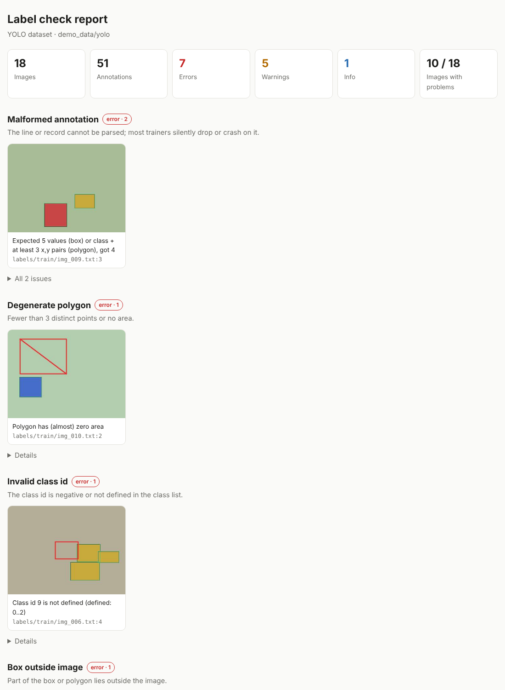

# labelcheck

Find the mistakes in your object-detection and segmentation labels **before** training does.

`labelcheck` scans a YOLO or COCO dataset and gives you a terminal summary, a JSON report for scripts, and a single self-contained HTML report that shows a thumbnail of every problem with the offending box drawn in red.



**[Live demo report](https://therealclvn.github.io/labelcheck/examples/demo_report_yolo.html)**: open it to see a full report, generated from a small synthetic dataset with deliberate mistakes.

Works well together with [labelprep](https://github.com/therealclvn/labelprep), which cuts videos into frames, converts YOLO <-> COCO, and splits train/val without leaking frames of the same video.

## Install

```bash
pip install .            # from a clone of this repository
pip install ".[yaml]"    # optional: PyYAML for reading complex data.yaml files
```

Requires Python 3.9+ and Pillow. It reads only image headers, so large datasets stay fast, and it never modifies your files.

## Quick start

```bash
# YOLO: a folder with images/ and labels/ (or Roboflow-style train/ valid/ test/ folders that contain them)
labelcheck yolo path/to/dataset --html report.html

# YOLO with a different layout
labelcheck yolo . --images data/pics --labels data/txt --names classes.txt

# COCO (pass --images to also check files on disk, sizes and get thumbnails)
labelcheck coco annotations.json --images path/to/images --html report.html --json report.json
```

Class names are picked up automatically from `data.yaml` or `classes.txt` in the dataset folder, or via `--names`. Both box lines (`class cx cy w h`) and polygon lines (`class x1 y1 x2 y2 ...`) are supported.

## What it checks

| Severity | Check | Typical cause |
|---|---|---|
| error | Box or polygon outside the image | export or resize bug, wrong image size |
| error | Zero or negative width/height | mis-click, bad conversion |
| error | Class id negative or not in the class list | label map changed between exports |
| error | Malformed line or record (wrong field count, NaN, non-numeric) | hand edits, broken scripts |
| error | Degenerate polygon (fewer than 3 distinct points, no area) | collapsed segmentation |
| error | Unreadable image / missing image file | corrupt download, moved files |
| error | COCO: declared width/height differ from the real image | boxes are misplaced on the whole image |
| error | COCO: annotation points to an unknown image id | merged or filtered datasets |
| warning | Duplicate box (same class, IoU >= 0.95) | double annotation |
| warning | Same box with two different classes | annotator disagreement |
| warning | Very small box (shorter side < 2 px) | accidental click |
| warning | Image without label file / label file without image | renamed or deleted files |
| info | Empty annotation | background image, or forgotten work |

The class distribution is included at the end of the HTML report.

## Options

| Option | Default | Meaning |
|---|---|---|
| `--html FILE` | | HTML report with thumbnails |
| `--json FILE` | | full machine-readable report |
| `--min-side PX` | 2 | boxes with a shorter side below this are flagged |
| `--dup-iou X` | 0.95 | IoU at or above this counts as a duplicate |
| `--max-thumbs N` | 12 | thumbnails per problem type in the HTML report |
| `--fail-on {error,warning,never}` | error | exit status 1 when problems of this severity exist |
| `-q` | | only print totals |

Exit status: `0` clean (by `--fail-on`), `1` problems found, `2` the dataset could not be read.

## Use in CI

```yaml
- run: pip install git+https://github.com/therealclvn/labelcheck
- run: labelcheck yolo data --fail-on error --json labelcheck.json
```

## Use as a library

```python
from labelcheck import load_yolo, check_dataset

ds = load_yolo("path/to/dataset")
result = check_dataset(ds)
print(result.stats["errors"], "errors")
for issue in result.issues:
    print(issue.severity, issue.code, issue.source, issue.message)
```

## Tested on real data

Besides the unit tests and the synthetic demo, it was run on the public [coco128](https://github.com/ultralytics/assets/releases) subset of COCO (128 images, 929 boxes). Result: 0 errors and 7 warnings, all checked by hand:

- 2 images have no label file and 2 label files have no image (`000000000250`, `000000000508` and `000000000656`, `000000000659`): a genuine mismatch in the dataset.
- 3 "very small box" warnings are real annotations of tiny objects (for example a 1.9 x 2.8 px ball). They are correct findings but not necessarily mistakes: for small-object data such as aerial footage, lower the threshold with `--min-side 1` or turn the check off with `--min-side 0`.

It was then run on five more public datasets that Ultralytics hosts as ready-made YOLO downloads (about 7,000 images in total). Every finding was checked by hand:

| Dataset | Images | Annotations | Findings | Checked by hand |
|---|---|---|---|---|
| brain-tumor | 1,116 | 1,166 | 15 images without a label file | All 15 images visibly show the same kind of bright lesion that is boxed on neighbouring slices of the same scan (for example `00360_102` is labelled, `00360_108` to `00360_126` are not). A missing label file means "no object here" to YOLO, so these teach the model that a tumor is background. |
| crack-seg (polygons) | 4,029 | 5,290 | 7 duplicate shapes, 1 very small box, 1 empty file | The 7 duplicates are the same crack traced twice, repeated across augmented copies of 3 source images. The very small box is a stray 9-point sliver lying on top of the main crack outline. The empty file belongs to an image with two clearly visible cracks. |
| medical-pills | 115 | 2,022 | none | |
| signature | 178 | 178 | none | |
| african-wildlife | 1,504 | 2,685 | none | |

No false alarms were found on these datasets, but they are still a limited test. Please open an issue if you see a finding that looks wrong on your data.

## Notes and limits

- Coordinates are judged with a small tolerance (0.1% of the image for YOLO, 1 px for COCO) so rounding does not trigger false alarms.
- COCO run-length-encoded masks are not inspected; their `bbox` is still checked.
- A box is only flagged as a duplicate when it overlaps *almost exactly*. Heavily overlapping but different objects are left alone.
- Oriented boxes and keypoints are not supported yet.

## Development

```bash
pip install -e ".[test]"
pytest
python examples/make_demo.py demo_data   # regenerate the synthetic demo datasets
```

## License

MIT, see [LICENSE](LICENSE).
